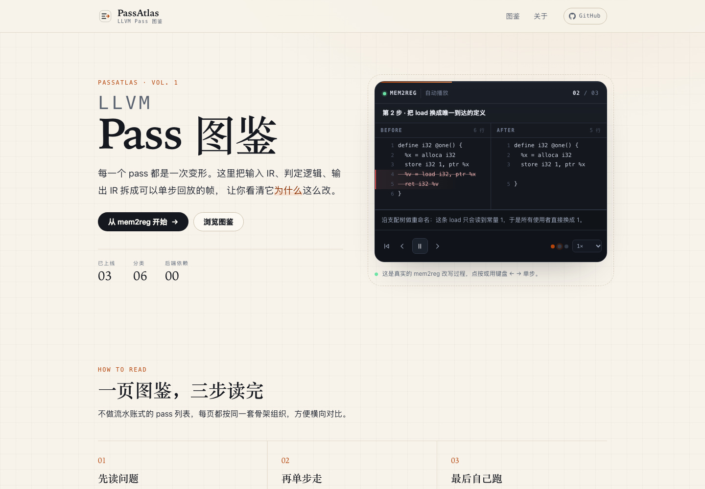
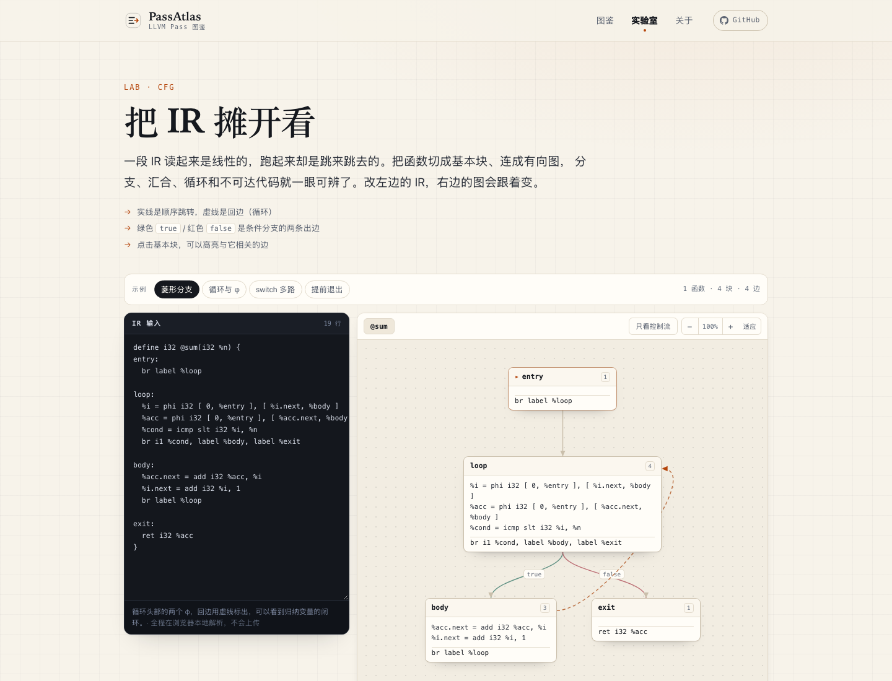

# PassAtlas · LLVM Pass 图鉴

> 每一个 pass，都是一次变形。

**在线地址：<https://herrcai0907.github.io/passatlas/>**

一个用**可交互动画**讲清 LLVM 优化 pass 的静态学习站。每篇图鉴固定回答五件事：它解决什么问题、算法怎么走、IR 怎么被改写、代价在哪、以及一条你能自己跑的命令。



## 特性

- **分步动画**：before / after 双栏对照，构建期自动做行级 diff；绿线是新增、红线是删除、琥珀色是「看这里」。支持 `←` `→` 单步、`空格` 播放、速度调节与跳步。
- **默认 CFG 视图**：所有 IR 展示模块（分步动画、实验室、独立图组件）都默认把 IR 画成基本块有向图，右上角一键切回 IR 文本。循环回边用虚线、条件分支的 `true` / `false` 分开着色，点击基本块高亮相关边。
- **100% 静态**：构建产物是纯 HTML / CSS / JS，无后端、无数据库、无追踪脚本，扔进任何静态托管都能跑，也可以完全离线阅读。
- **内容即代码**：每篇 pass 是一个 MDX 文件，frontmatter 由 Zod 校验；写错字段、写错分类，构建直接失败。
- **零配置部署**：push 到 `main` 自动构建并发布到 GitHub Pages，项目站点子路径（`/repo-name/`）自动处理。
- **可访问**：键盘全可操作、focus 可见、`prefers-reduced-motion` 下自动停播并关闭动画。
- **中英双语**：默认语言是中文（无路径前缀），英文在 `/en/` 下。语言选择器列出中文和 English，并保持当前页面，head 里带 `hreflang`，sitemap 也声明两种语言的对应关系。

## 快速开始

```bash
npm install
npm run dev       # http://localhost:4321
npm run build     # 静态产物输出到 dist/
npm run preview   # 本地预览 dist/
npm run check     # TypeScript / Astro 模板类型检查
npm run test:ir   # IR 解析器、CFG 布局与 i18n 的断言测试（Node 直接跑 TS）
```

要求 Node `>= 22.23.4`，版本见 `.nvmrc`。

## 目录结构

```text
src/
├── pages/
│   ├── [...locale]/       路由：一次生成中文（无前缀）与英文（/en/）
│   │   ├── index.astro    首页：hero 动画 + 精选图鉴
│   │   ├── passes/index.astro 图鉴目录（IR PGO 分组 + 分类 + 管线图）
│   │   ├── passes/[...slug].astro  pass 详情（构建期生成）
│   │   ├── passes/pgo-instr-gen/[...slug].astro PGO 采样点详情（挂在本页下）
│   │   ├── ir/index.astro CFG 实验室：贴 IR 看控制流
│   │   └── about.astro    方法论与贡献说明
│   └── 404.astro / robots.txt.ts   根路径专用
├── i18n/                  config.ts（语言）· ui.ts（文案）· paths.ts · lab-scc.ts
├── layouts/               BaseLayout（head / meta / hreflang / 页头页脚）
│                          PassLayout（详情页骨架 + 上一篇/下一篇）
│                          PgoLayout（采样点骨架 + 消费者/相关页）
├── components/
│   ├── StepPlayer.tsx     分步 IR 播放器
│   ├── CFGViewer.tsx      IR → 基本块有向图（纯前端解析 + 分层布局）
│   ├── CFGLab.tsx         实验室：可编辑 IR + 实时重绘
│   ├── PassCard/PassRow   卡片（首页）与行（目录）
│   └── ...                页头、页脚、管线标记
├── content/passes/zh/     每篇一个中文 .mdx
├── content/passes/en/     同一 id 的英文 .mdx
├── content/passes/{zh,en}/pgo-instr-gen.mdx  IR PGO 插桩 pass 页
├── content/pgo/zh/        每个采样点一个中文 .mdx
├── content/pgo/en/        同一 id 的英文 .mdx
├── demos/                 演示数据：types.ts（diff 引擎）+ 每个 pass 一份
├── lib/
│   ├── url.ts             base path + 语言前缀安全的链接助手
│   ├── passes.ts          内容 id → slug / locale 的助手
│   └── ir/                parse.ts（IR → 基本块）· layout.ts（分层布局）
├── data/                  pipeline.ts · pass-registry.ts · cfg-samples.ts · pgo.ts（采样点事实）
└── styles/                tokens.css（设计令牌）· global.css（基础 + prose）
```

## 新增一篇 pass

完整规范见 [`AGENTS.md`](AGENTS.md)，核心只有四步：

1. **写演示数据** `src/demos/<id>.ts`：只提供 `before` / `after` 两段 IR，行级 diff 由 `makeStep()` 在构建期计算；第四参数补英文标题与说明。

   ```ts
   import { makeDemo } from './types.ts';

   export const exampleDemo = makeDemo('example', 'example', [
     {
       title: '第 1 步 · 消掉恒等运算',
       note: 'add x, 0 不改变值，直接用操作数替换使用者。',
       before: `
   %a = add i32 %x, 0
   ret i32 %a
   `,
       after: `
   ret i32 %x
   `,
     },
   ], {
     en: {
       steps: [
         {
           title: 'Step 1 · Remove the identity add',
           note: 'add x, 0 does not change the value; replace every use with the operand.',
         },
       ],
     },
   });
   ```

2. **注册** `src/demos/registry.ts`：`example: exampleDemo`。播放器通过 `getDemo(id, locale)` 取对应语言。
3. **写中文页** `src/content/passes/zh/<id>.mdx`。
4. **写英文页** `src/content/passes/en/<id>.mdx`，frontmatter 里 `demo: example`，正文用对应的英文小节标题。

```yaml
---
title: example
subtitle: 一句话短名          # 英文文件里写英文短名
summary: 会显示在卡片与 meta description 里
category: scalar        # dataflow | scalar | loop | interproc | vectorize | codegen
difficulty: 2           # 1–3
status: ready           # draft 不会生成页面
order: 10
stage: ['-O1', '-O2']
tags: ['Worklist']
demo: example
source: llvm/lib/Transforms/.../X.cpp
---
```

正文固定五个 `##` 小节（编号由 CSS 自动生成）：它解决什么问题 / 算法 / 代价与坑 / 在管线里的位置 / 自己跑一遍。英文页使用 What problem does it solve / Algorithm / Cost and pitfalls / Where it sits in the pipeline / Run it yourself。MDX 里的站内链接用 `<I18nLink href="/passes/other/">`，它会自动带当前语言前缀。

## CFG 视图与实验室

`CFGViewer` 把一段 LLVM IR 切成基本块并画成有向图：解析和布局都是无依赖的纯函数，构建期就能渲染出 HTML，浏览器里只负责交互。

**所有 IR 展示模块默认是 CFG 图，可随时切到 IR 文本**：分步动画（`StepPlayer`）的 before / after 两个面板、实验室、以及独立嵌图都共用同一个 `[CFG | IR]` 切换。



- **实验室**：打开 [`/ir/`](https://herrcai0907.github.io/passatlas/ir/)，左边改 IR，右边实时重绘；也能用 `/ir/?sample=loop`、`/ir/?sample=switch` 直达示例。
- **pass 页里嵌图**：在 frontmatter 里写 `cfg: diamond`（对应 `src/data/cfg-samples.ts` 的 id）。当该页没有分步演示时，页面会自动多出一节「控制流图」；有演示的页面直接用播放器里的 CFG 模式，避免同一张图出现两次。
- **任意位置调用**：

  ```mdx
  import CFGViewer from '../../components/CFGViewer';

  <CFGViewer ir={someIR} client:visible height={520} />
  ```

- **测试**：`npm run test:ir`，覆盖菱形分支、循环回边、switch 多路、不可达块、跨行指令、错误提示，以及中英文路径与演示文案。

## IR PGO 分组

图鉴顶部新增 **IR PGO** 分组，不再有独立的顶层栏目。先读插桩 pass `pgo-instr-gen`：它解释 IR 里插了哪些值、第二次编译把它们变成什么元数据，并指向消费这些值的 pass（`pgo-icall-prom`、`pgo-memop-opt`、`inliner` 等）。

- 插桩 pass：`/passes/pgo-instr-gen/`；五个采样点详情：`/passes/pgo-instr-gen/function-entry/`、`.../basic-block/`、`.../indirect-call/`、`.../memop-size/`、`.../vtable/`。
- 插桩 pass 在 `src/content/passes/<locale>/pgo-instr-gen.mdx`，带分步演示；采样点正文在 `src/content/pgo/<locale>/<id>.mdx`，结构化事实在 `src/data/pgo.ts`，渲染骨架是 `src/layouts/PgoLayout.astro`。
- 采样点不是 pass，因此没有分步动画，也不进入 `passes` 集合；它们作为 `pgo-instr-gen` 的子页出现在图鉴的 IR PGO 分组里，并通过面包屑与父页互链。

## 多语言（i18n）

默认语言是中文，URL 没有前缀；英文在 `/en/` 下：

| 页面 | 中文 | 英文 |
| --- | --- | --- |
| 首页 | `/` | `/en/` |
| 图鉴 | `/passes/` | `/en/passes/` |
| pass 详情 | `/passes/mem2reg/` | `/en/passes/mem2reg/` |
| IR PGO 插桩 pass | `/passes/pgo-instr-gen/` | `/en/passes/pgo-instr-gen/` |
| PGO 采样点 | `/passes/pgo-instr-gen/function-entry/` | `/en/passes/pgo-instr-gen/function-entry/` |
| CFG 实验室 | `/ir/` | `/en/ir/` |
| 关于 | `/about/` | `/en/about/` |

约定：

- 文案在 `src/i18n/ui.ts`，用 `t(locale, key, vars)` 取；英文表按中文表的键做类型约束，漏键会让 `npm run check` 失败。
- 所有站内链接走 `url(path, locale)`；MDX 里用 `I18nLink`，它从当前 URL 推断语言。
- 内容按语言放在 `src/content/passes/<locale>/<id>.mdx`，两个语言的文件名必须一致，上一篇/下一篇和语言选择器靠它配对。
- 分类、管线图、CFG 示例、SCC 实验台和演示标题都有中英文两套；解析器错误信息也接受 locale 参数。
- `BaseLayout` 输出 `<html lang>`、`og:locale`、canonical 与 `hreflang`，sitemap 同样声明两种语言的对应关系。

## 部署到 GitHub Pages

工作流在 `.github/workflows/deploy.yml`：**push 到 `main` 即自动构建并发布**。

1. 把仓库推到 GitHub（建议仓库名就叫 `passatlas`，站点 URL 更干净）。
2. 打开 **Settings → Pages → Build and deployment**，把 **Source** 设为 **GitHub Actions**。只需设置一次。
3. push 到 `main`，在 **Actions** 里看 `Deploy to GitHub Pages` 跑完。
4. 站点地址：`https://<username>.github.io/<repo>/`。

细节：

- `BASE_PATH` 与 `SITE_URL` 由工作流根据 `github.repository` 自动推导，所以**换仓库名不用改配置**。仓库名为 `<user>.github.io` 时自动使用根路径。
- 站点是静态目录格式（`/passes/mem2reg/index.html`），刷新子页面不会 404，无需 `404.html` 兜底路由。
- 首次部署若报 `Pages site not found`，就是第 2 步没做。
- 自定义域名：在 Pages 设置里填域名，再给仓库加一个变量 `SITE_URL`（Settings → Secrets and variables → Actions → Variables），值填 `https://your.domain`，工作流会自动优先使用它。

本地模拟一次「项目站点」构建，确认子路径资源没问题：

```bash
BASE_PATH=/passatlas/ SITE_URL=https://example.github.io npm run build
npx serve dist   # 或任意静态服务器，访问 /passatlas/
```

## 设计约定

- 纸色底 + 墨色字 + 衬线标题，IR 控制台用深色反白；分类色通过 `--cat` 注入。
- 颜色、字体、圆角、阴影全部走 `src/styles/tokens.css`，组件里不写死色值。
- 所有站内链接必须经过 `src/lib/url.ts` 的 `url(path, locale)`，否则部署到子路径或英文页会 404。
- UI 文案只从 `src/i18n/ui.ts` 取，组件里不写死中文或英文。
- 交互只发生在少数 React 岛上（`StepPlayer`、`CFGViewer`、`CFGLab`、`SCCInlinerLab`），其余页面是纯静态 HTML。

更完整的约束、动画规范与「完成定义」见 [`AGENTS.md`](AGENTS.md)。

## 管线图

图鉴目录里的管线图按 LLVM 新版 PassManager 的 IR 层级组织：Module → CGSCC →
Function → Loop，最后切到 Machine IR。主图覆盖默认优化管线的主干（带 `*` 的 pass 只在
特定优化级别 / PGO 或 target 下启用）；已经写好的 pass 是彩色链接，点进去就是对应页面，
还没写的节点是灰色虚线。

代码生成没有被压成一个「黑盒」阶段，而是拆成指令选择、机器级 SSA 化简、拆 SSA 与预分配
调度、寄存器分配、栈帧与后分配优化、MC 发射六段，并把 x86-64 与 AArch64 的 target-specific
pass 用 `x86` / `arm64` 徽标标出。地图下方还有两条目标线的并排视图：同一段 IR 在两条线上
的 MIR 落点、每个阶段由 `X86PassConfig` / `AArch64PassConfig` 插入的 pass，以及分配前后的
物理寄存器对比。已收录的三篇机器级页面是：

- [`/passes/isel/`](src/content/passes/zh/isel.mdx)：IR → Machine IR，SelectionDAG 与 GlobalISel
- [`/passes/phi-elim/`](src/content/passes/zh/phi-elim.mdx)：φ 变 COPY、critical edge 拆分
- [`/passes/regalloc/`](src/content/passes/zh/regalloc.mdx)：greedy、coalescing、spill

Machine IR 阶段的数据在 [`src/data/machine.ts`](src/data/machine.ts)，主图在
[`src/data/pipeline.ts`](src/data/pipeline.ts) 里由它生成；两条目标线的视图是
[`src/components/MachineTrack.astro`](src/components/MachineTrack.astro)。主图下方还有一个
默认折叠的完整注册表：LLVM 23.1.4 的 `PassRegistry.def` 里 367 个 pass 注册项，按
Module / CGSCC / Function / Loop / Loop nest 分组。注册表快照在
[`src/data/pass-registry.ts`](src/data/pass-registry.ts)。节点名与
`src/content/passes/<locale>/` 里的 slug 相同就会自动点亮，不需要第二份清单。想加速某一个，
直接提 PR。

## 许可

代码与内容以 [MIT](LICENSE) 许可发布。LLVM 是 UIUC 的商标，本项目与 LLVM 项目无隶属关系；文中引用的源码片段遵循 LLVM 自身的 Apache-2.0 WITH LLVM-exception 许可。
